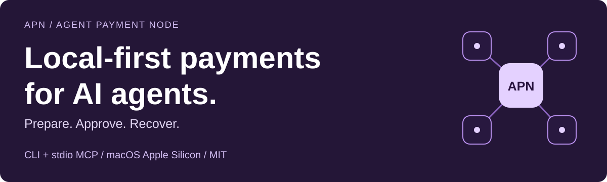

# Agent Payment Node (APN)

[](https://github.com/NipunaRanasinghe/awesome-ai-agents)

**Agent Payment Node (APN)** is an open-source, local-first payment runtime and MCP server for AI agents. An agent drives it through the `apn` CLI or a local
stdio MCP server; a human owner sets the limits and approves payments in a foreground terminal, and x402 purchases run
inside a policy the owner activated. APN keeps each
payment as a durable operation with an idempotency key, so a crash or a lost response never sends the same money twice.



**macOS Apple Silicon · Node 24 · MIT · TypeScript · CLI + stdio MCP**

Website: [agentpaymentnode.com](https://agentpaymentnode.com)

[Install](#install) · [What can you do?](#what-can-you-do) · [Connect MCP](#connect-an-mcp-client) ·
[Documentation](docs/README.md) · [Releases](https://github.com/nuanu-ai/agent-payment-node/releases) ·
[Security](SECURITY.md)

### What is APN?

APN lets an AI agent pay without holding unlimited access to a wallet. The agent prepares a payment, and APN checks it
against limits the owner set. Direct transfers wait for the owner to approve them in a terminal; x402 purchases run
only inside a spending policy the owner activated. If the process crashes mid-payment, APN finds the saved operation
and does not send the money twice.

It covers:

- direct transfers of native coins and listed tokens on EVM networks, Solana and TRON;
- standard x402 purchases (EIP-3009 USDC, Permit2, ERC-20 transfer-proof merchants);
- USDC transfers whose gas is paid from the USDC amount (local wallet, MetaMask Agent Wallet, MetaMask Smart Account,
  Coinbase, PayAI facilitator) and Ethereum USDT through a keyless sponsor;
- bridges (LI.FI with Across and Stargate, Relay, Circle CCTP V2, GasZip, NEAR 1Click, direct Stargate V2);
- guarded swaps (Uniswap V3 on Ethereum, SunSwap on TRON, Jupiter and Orca on Solana);
- an owner allowlist that admits each asset, rail and mechanism with per-operation and daily caps.


APN runs on Apple Silicon macOS with Node 24. The [platform support matrix](docs/platform-support.md) records the
boundary and what Linux or Windows would need. A matching version number does not prove that an installed artifact
contains a given source change: check `apn --version`, the release provenance and `apn help --json` together.

## Install

```sh
brew install nuanu-ai/tap/apn
apn --version
apn help --json
```

The Formula installs `apn` and the Homebrew `node@24` dependency. Discovery commands run before any state, Keychain,
wallet, policy, network or signing work. See [Getting started](docs/getting-started.md) for the full install text,
[Verify a release](docs/release-verification.md) for release checks and the
[release list](https://github.com/nuanu-ai/agent-payment-node/releases) for current versions.

## What can you do?

| Scenario | Where to start |
| --- | --- |
| Buy from a seller that accepts x402 | `apn x402 inspect`, then `apn x402 fetch prepare` and `approve`. See [x402 purchases](docs/x402-purchases.md). |
| Send a direct transfer | On EVM: `apn pay transfer prepare-asset`, then `approve` in a foreground terminal. Solana and TRON have their own commands. See the [first journey](docs/first-journey-reference.md). |
| Connect an AI agent | `apn mcp config` and `apn mcp serve`. See [MCP setup](docs/mcp.md). |
| Use Coinbase, MetaMask or another provider wallet | `apn wallet connect`. See [provider wallets](docs/provider-wallets.md). |
| Bridge or swap under owner limits | See [families](docs/families.md) and the guides in the [documentation index](docs/README.md). |
| Recover after an interruption | `apn operation status`, `operation resume`, `receipt get`. See [custody and recovery](docs/custody-and-recovery.md). |

Which networks, assets and providers work depends on the route. The [documentation index](docs/README.md) links to the
guide for each one.

## Connect an MCP client

```sh
apn mcp config
apn mcp serve
```

`apn mcp config` prints the launch descriptor and `apn mcp serve` runs the local stdio server. Your MCP client starts it
as a local process. The agent never approves a payment: a command that needs a human returns the exact command to run in
a terminal. There is no hosted remote MCP endpoint in this repository. See [MCP setup](docs/mcp.md).

## How APN works

An agent prepares a payment. A `prepare` command freezes one exact effect (chain, asset, amount, recipient, fee budget)
under an idempotency key and signs nothing. An `approve` or `execute` command re-checks the frozen facts and the active
owner policy, shows the exact terms in a foreground terminal and asks for a typed code before signing. Every send is
behind a durable marker, and an ambiguous send is observed before anything else. The full text is in
[How APN works](docs/how-it-works.md).

## Documentation

| Need | Guide |
| --- | --- |
| Install and discover the commands | [Getting started](docs/getting-started.md) |
| A first direct transfer | [First journey](docs/first-journey-reference.md) |
| Pay an x402 seller | [x402 purchases](docs/x402-purchases.md) |
| Connect an agent | [MCP setup](docs/mcp.md) |
| Wallets and providers | [Provider wallets](docs/provider-wallets.md) |
| RPC endpoints and balances | [RPC configuration](docs/rpc-configuration.md), [Portfolio](docs/portfolio.md) |
| All commands | [Command reference](docs/command-reference.md) |
| Keys, threat model, recovery | [Custody and recovery](docs/custody-and-recovery.md) |
| Check a release | [Verify a release](docs/release-verification.md) |
| Everything else | [Documentation index](docs/README.md) |

### Where the previous README sections went

The README was shortened. Its detailed sections moved word for word into `docs/`. Old links to these headings still land here.

| Previous section | Now in |
| --- | --- |
| <a id="discover-the-installed-contract"></a>Discover the installed contract | [docs/getting-started.md](docs/getting-started.md#discover-the-installed-contract) |
| <a id="verify-a-release"></a>Verify a release | [docs/release-verification.md](docs/release-verification.md) |
| <a id="first-journey-a-direct-base-usdc-transfer"></a>First journey: a direct Base USDC transfer | [docs/first-journey-reference.md](docs/first-journey-reference.md) |
| <a id="x402-purchases"></a>x402 purchases | [docs/x402-purchases.md](docs/x402-purchases.md) |
| <a id="provider-wallets"></a>Provider wallets | [docs/provider-wallets.md](docs/provider-wallets.md) |
| <a id="families"></a>Families | [docs/families.md](docs/families.md) |
| <a id="rpc-configuration"></a>RPC configuration | [docs/rpc-configuration.md](docs/rpc-configuration.md) |
| <a id="portfolio"></a>Portfolio | [docs/portfolio.md](docs/portfolio.md) |
| <a id="command-reference"></a>Command reference | [docs/command-reference.md](docs/command-reference.md) |
| <a id="custody-and-threat-model"></a>Custody and threat model | [docs/custody-and-recovery.md](docs/custody-and-recovery.md#custody-and-threat-model) |
| <a id="recovery-guarantees"></a>Recovery guarantees | [docs/custody-and-recovery.md](docs/custody-and-recovery.md#recovery-guarantees) |
| <a id="proof-boundary"></a>Proof boundary | [docs/custody-and-recovery.md](docs/custody-and-recovery.md#proof-boundary) |

## Security and custody

APN never prints or exports a private key. Read the [custody and threat model](docs/custody-and-recovery.md) before
funding a wallet. Report a vulnerability privately, as [SECURITY.md](SECURITY.md) describes, and never in a public issue.

## Contributing

[Open an issue](https://github.com/nuanu-ai/agent-payment-node/issues/new/choose) for a bug, an installation problem or a
documentation suggestion. Include the output of `apn --version` and remove secrets. See [CONTRIBUTING.md](CONTRIBUTING.md).

## License

Licensed under the [MIT License](LICENSE).

<a id="agent-payment-node"></a>
